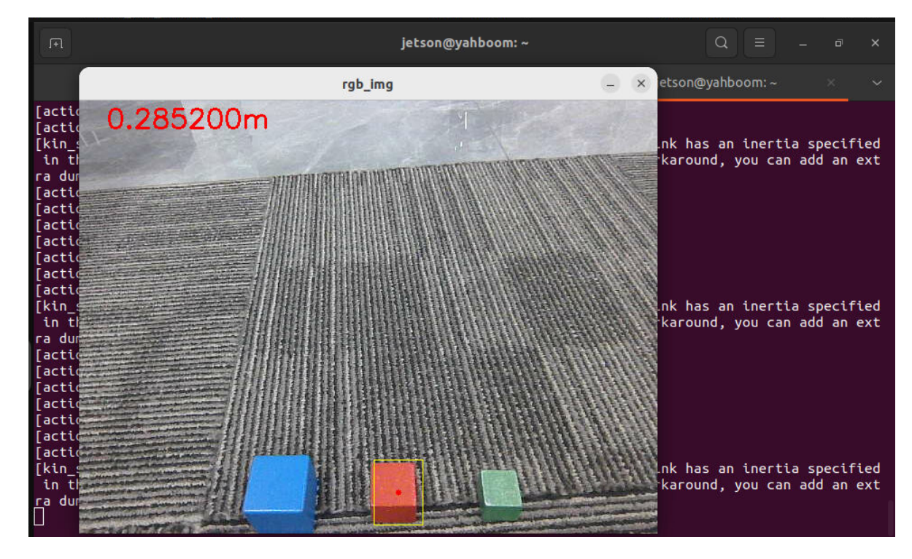
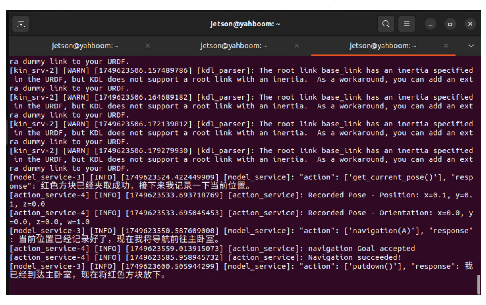
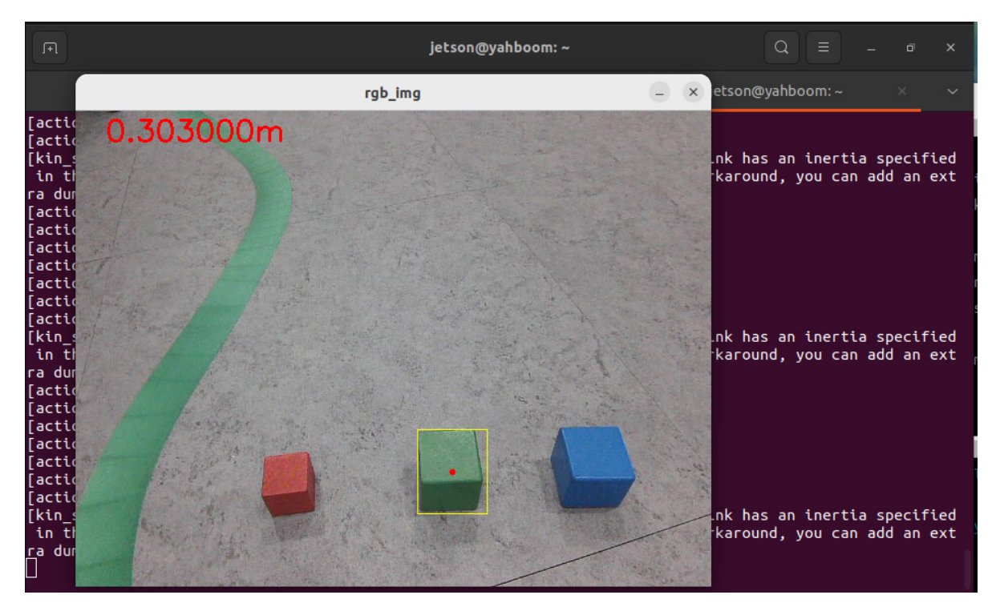

# **Robotic arm gripping + multimodal visual understanding + SLAM navigation**

## **1. Course Content**

- 1. Learn robot SLAM navigation, robotic arm gripping, and AI large model visual understanding composite function cases
- 2. Study the new key source code in the tutorial
- 3. **Note: This section requires you to first configure the map mapping file according to the previous section Multimodal Visual Understanding + SLAM Navigation**

## **2. Preparation**

### **2.1 Content Description**

This course uses the Jetson Orin NX as an example. For Raspberry Pi and Jetson Nano boards, you need to open a terminal on the host computer and enter the command to enter the Docker container. Once inside the Docker container, enter the commands mentioned in this course in the terminal. For instructions on entering the Docker container from the host computer, refer to the **[Configuration and Operation Guide] -- [Enter the Docker (Jetson Nano and Raspberry Pi 5 users see here)]** section of this product tutorial. For Orin and NX boards, simply open a terminal and enter the commands mentioned in this course.

#### **2.2 Start the Agent**

**Note: To test all cases, you must start the docker agent first. If it has already been started, you do not need to start it again.**

Enter the command in the vehicle terminal:

```
sh start_agent.sh
```

The terminal prints the following information, indicating that the connection is successful

## **3. Run the case**

#### **3.1 Startup Program**

Open the terminal on the vehicle and enter the command:

```
ros2 launch largemodel largemodel_control.launch.py text_chat_mode: = True
```

Take the virtual machine as an example, open a terminal and start

```
ros2 run text_chat text_chat
```

#### **3.2 Test Cases**

Here are two reference test cases, users can compile their own test instructions

Help me take the red block in front of you to the master bedroom, and then take the green block from the master bedroom to the kitchen.

Copy and enter the above test case in the text interactive terminal:

The decision-making model outputs the planned task steps:

t\_chat\_node]: robot response: The upcoming task to be carried out: 1. 调用视 觉函数获取红色方块在画面中的坐标

- 2. 使用机械臂夹取红色方块
- 3. 记录当前所在位置
- 4. 导航前往主卧室
- 5. 放下红色方块
- 6. 重新调用视觉函数获取绿色方块的位置
- 7. 使用机械臂夹取绿色方块
- 8. 导航前往厨房
- 9. 放下绿色方块

The execution layer model will then execute the task steps:

```
user input: [INF0] [1749639184.539887469] [text chat node]: robot response:
action": ['seewhat()'],"response": 好的,我先看看面前的红色方块在哪里。
[INFO] [1749639190.143151310] [text chat node]: robot response: "action": ['g
rasp_obj(325, 287, 374, 346)'], "response": 我已经看到了红色方块的位置,现在
准备用机械臂夹取它。
[INFO] [1749639222.621630102] [text_chat_node]: robot response: "action": ['g
et current pose()'], "response": 红色方块已经夹取成功啦,接下来我需要记录一下
当前位置。
[INFO] [1749639226.216263475] [text chat node]: robot response: "action": ['n
avigation(A)'],"response":当前位置已经记录好了,现在我将导航前往主卧室。
[INFO] [1749639262.719828763] [text_chat_node]: robot response: "action": ['p
'utdown()'], "response": 我已经到达主卧室了,现在准备放下红色方块。
[INFO] [1749639273.046873263] [text_chat_node]: robot response: "action": ['s
eewhat()'], "response": 红色方块已经成功放下,接下来我需要看看主卧室里的绿色
方块在哪里。
[INFO] [1749639277.110579644] [text_chat_node]: robot response: "action": ['g
rasp_obj(358, 256, 404, 312)'], "response": 我已经看到了绿色方块的位置,现在
准备用机械臂夹取它。
[INFO] [1749639317.671182176] [text chat node]: robot response: "action": ['n
avigation(G)'], "response": 绿色方块已经夹取成功啦,现在我将导航前往厨房。
[INFO] [1749639342.209259442] [text chat node]: robot response: "action": ['p
utdown()'], "response": 我已经到达厨房了,现在准备放下绿色方块。
[INFO] [1749639352.627143524] [text_chat_node]: robot response: "action": ['f
inishtask()'], "response": 绿色方块已经成功放下,所有任务都完成了! 还有什么需
要我帮忙的吗?
```

The robot will grab the red block in front of it first according to the instructions


[Image details](images/img_001.md)

Then navigate to the "Master Bedroom" and use the robotic arm to place the red block


[Image details](images/img_002.md)

After re-observing and finding the green block in the "Master Bedroom", go to the "Kitchen"


[Image details](images/img_003.md)

After placing the green block in the "kitchen", the robot will prompt that the task is completed and enter the waiting state. At this time, enter "End current task" in the interactive terminal to let the robot end the task.

## **4. Source code analysis**

The source code is located at:

jetson orin nano, jetson orin NX host:

/home/jetson/M3Pro\_ws/src/largemodel/largemodel/src/largemodel/largemodel/action \_service.py

Jetson Nano, Raspberry Pi host, you need to enter Docker first:

root/M3Pro\_ws/src/largemodel/largemodel/src/largemodel/largemodel/action\_service .py

action\_service.py program:

The case in this section is a composite case: it uses **the seewhat** , **navigation** , **load\_target\_points** , **putdown** , and **grasp\_obj** methods in **the CustomActionServer** class , which have been explained in the previous sections [2. Multimodal Visual Understanding, 3. Multimodal Visual Understanding + Robotic Arm Grasping, and 4. Multimodal Visual Understanding + SLAM Navigation].

action\_service.py program:

The case uses **the seewhat** , **navigation** , **load\_target\_points** , **putdown** , and **grasp\_obj** methods in **the CustomActionServer class. Seewhat** , **navigation, load\_target\_points** , and **grasp\_obj** have been explained in the previous chapters [2. Multimodal Visual Understanding, 3. Multimodal Visual Understanding + Robotic Arm Grabbing, and 4. Multimodal Visual

Understanding + SLAM Navigation]. Here we explain the newly appeared **putdown function.**

The putdown function controls the robotic arm to put down the object it has gripped. After gripping an object, the robotic arm will be in a gripping state. Calling this function allows the robotic arm to put down the gripped object. The principle is to control the robotic arm posture by publishing the robotic arm joint topic.

```
def putdown ( self ):
    self . pubSix_Arm ( self . putsown_joints ) # Lower the robotic arm
    time . sleep ( 3 )
    self . pubSingle_Arm ( 6 , 30 , 2000 ) #The robotic arm opens the grip and
puts down the item
    time . sleep ( 3 )
    self . pubSix_Arm ( self . init_joints ) #Robotic arm retracts
    self . action_status_pub ( f'Robot feedback: Execution of putdown()
completed' )
```