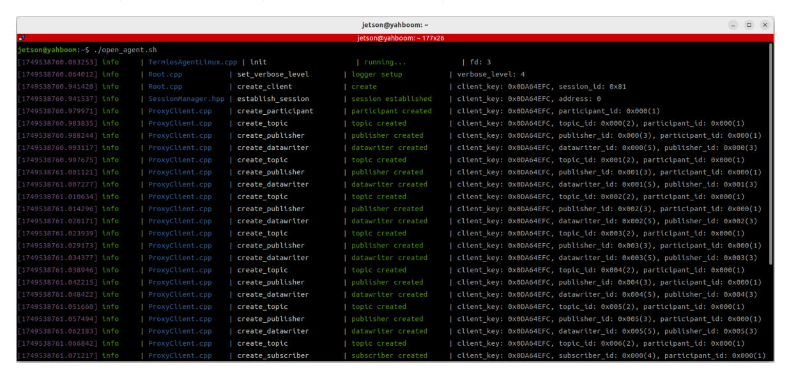
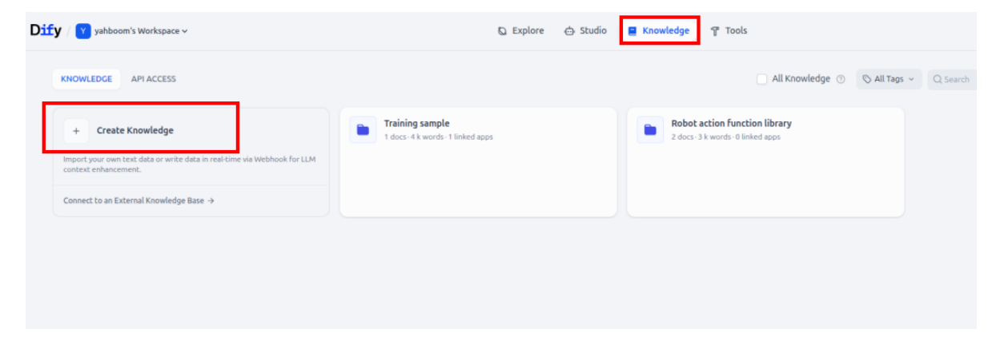
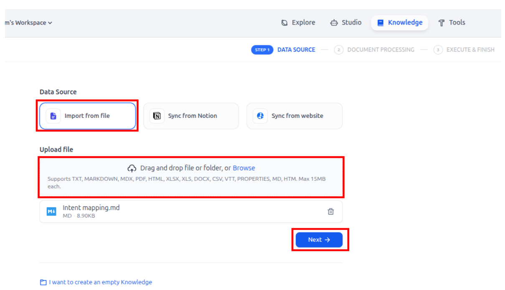
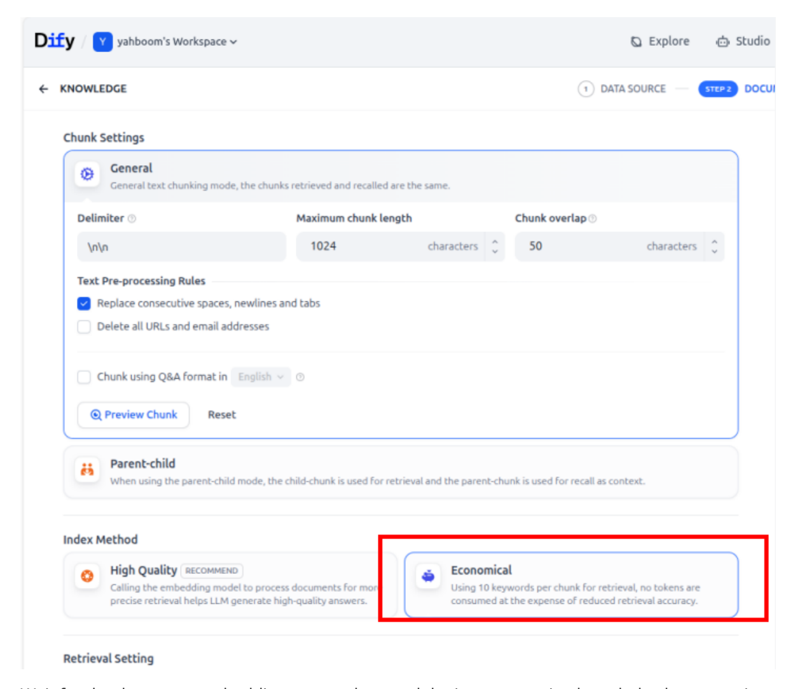
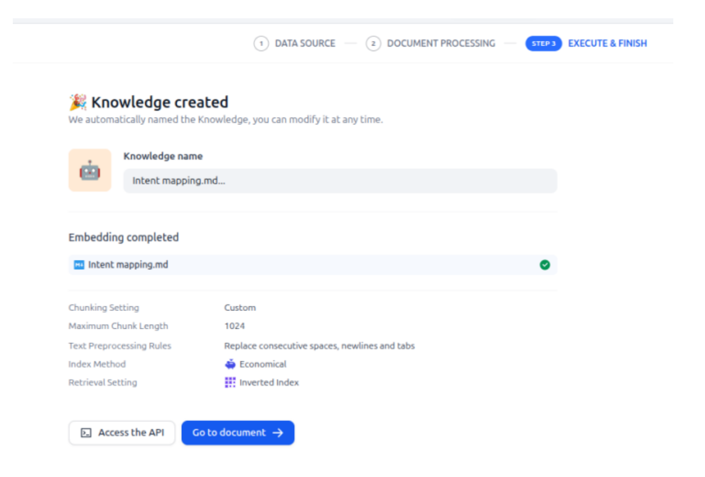
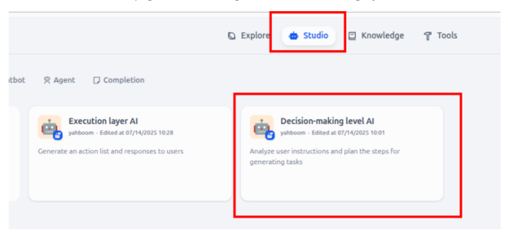
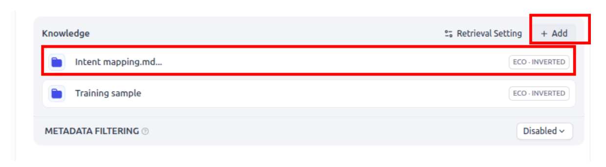
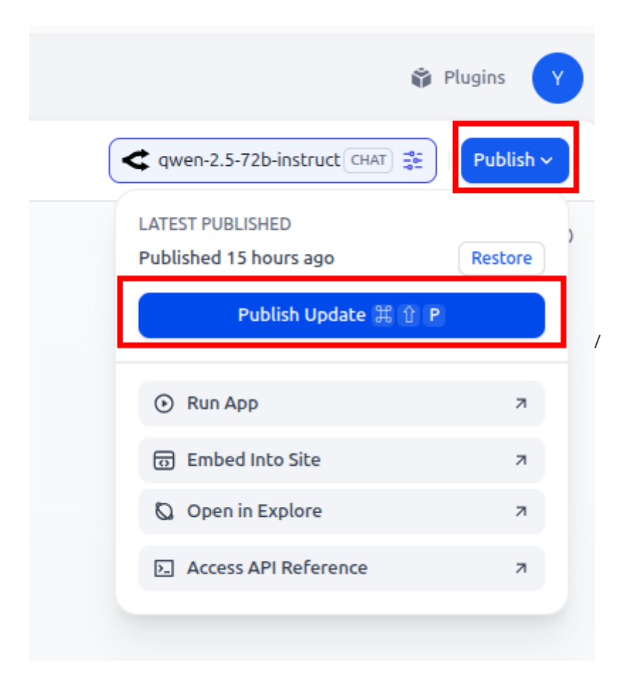
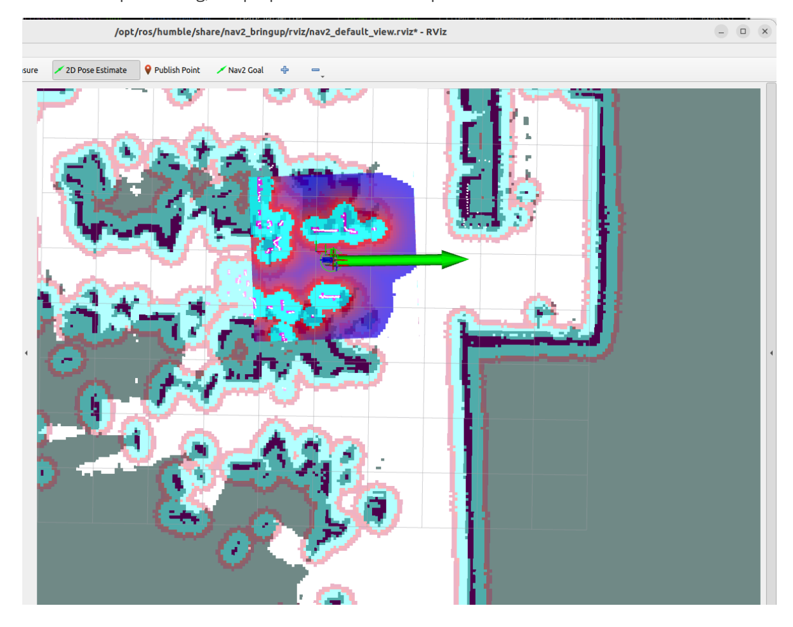
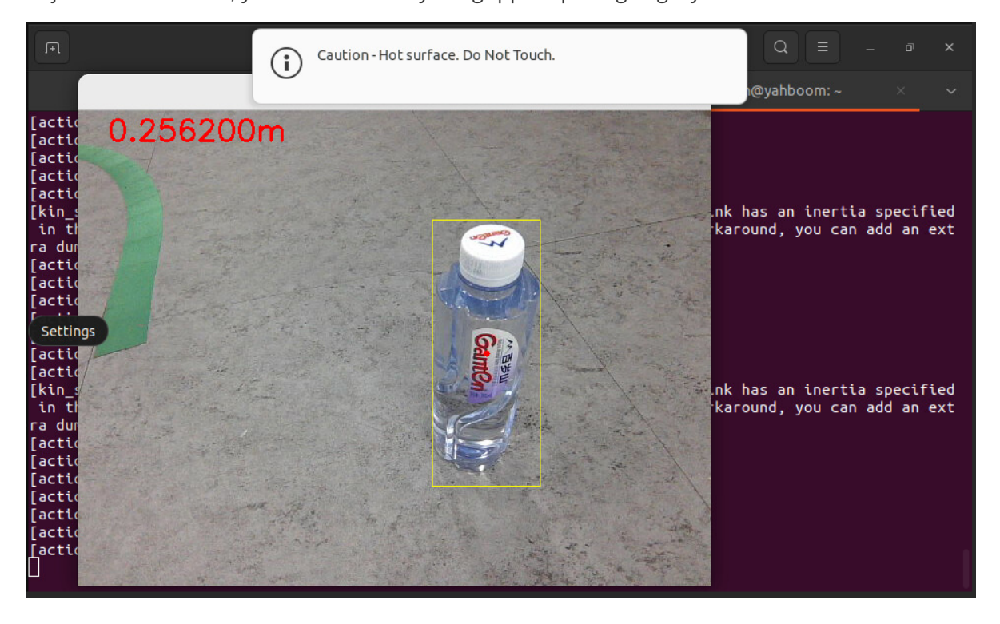

# **Intention understand planning+Multimodal visual understand+robotic arm grab+SLAM Navigation**

### **1. Course Content**

**Note: This chapter requires you to first complete the configuration of the map mapping file according to the [Multimodal Visual Understanding + SLAM Navigation] chapter course.**

Learn to use the RAG knowledge base to train personal intent understanding

#### **Course Review:**

The concept and function of the RAG knowledge base are explained in the chapter [2. Basic Knowledge of AI Big Models - 2. RAG Retrieval Enhancement and Model Training Samples]. In the chapter [2. Basic Knowledge of AI Big Models - 5. Configuring AI Big Models], the section [5. RAG Knowledge Base and Training Samples] explains how to configure and expand the RAG knowledge base, and also configures the necessary [Robot Action Function Library].

The RAG knowledge base can be used to expand the knowledge of the large model. This course explains how to expand the RAG knowledge base so that the large model can understand personal intentions.

#### **Special attention!!!** :

- 1. The ability to expand personal intent understanding varies from user to user, and the large model's responses are divergent, so the actual debugging results may not be exactly the same.
- 2. Expanding the personal intent understanding function must comply with social norms and laws and regulations. Technical services are not responsible for the final debugging results and impacts of this course.

### **2. Preparation**

### **2.1 Content Description**

This course uses the Jetson Orin NX as an example. For Raspberry Pi and Jetson Nano boards, you need to open a terminal on the host computer and enter the command to enter the Docker container. Once inside the Docker container, enter the commands mentioned in this course in the terminal. For instructions on entering the Docker container from the host computer, refer to the **[Configuration and Operation Guide] -- [Enter the Docker (Jetson Nano and Raspberry Pi 5 users see here)]** section of this product tutorial. For Orin and NX boards, simply open a terminal and enter the commands mentioned in this course.

#### **2.2 Start the Agent**

**Note: To test all cases, you must start the docker agent first. If it has already been started, you do not need to start it again.**

Enter the command in the vehicle terminal:

```
sh start_agent.sh
```

The terminal prints the following information, indicating that the connection is successful


[Image details](images/img_001.md)

## **3. Configuration Document**

### **3.1 Create a txt document**

Open the [Intent Mapping.txt] in the folder of this course

This case takes the setting of [Intent Mapping] and [Item Storage Location] as an example (you can add multiple files and more customized information by yourself)

**[Intent Mapping]** : Stores personal intentions and expectations to control the robot to operate

**[Item Storage Location]** : Store personal intentions and expectations. Large models control the robot to operate.

#### **3.2 Upload to RAG Knowledge Base**

Then follow the steps in [2. AI Big Model Basics - 5. Configuring AI Big Model - 7.International Version Configuration - 7.5 Expanding the Knowledge Base] to upload the .txt format document.

Click on the knowledge in the main interface of the diify interface, and then click Create knowledge to create a new knowledge base


[Image details](images/img_002.md)

Select import from file, then click browser to browse to browse local files and upload, and click Next after uploading


[Image details](images/img_003.md)

Select economic mode, keep the others by default


[Image details](images/img_004.md)

Wait for the document embedding to complete, and the intent mapping knowledge base creation can be completed


[Image details](images/img_005.md)

Switch back to the home page and click Configure the decision-making layer model


[Image details](images/img_006.md)

Click add to add the knowledge base for the intent mapping just created


[Image details](images/img_007.md)

Click Publish to save the effective configuration


[Image details](images/img_008.md)

## **4. Run the case**

### **4.1 Startup Program**

Take the virtual machine as an example, open a terminal and start

```
ros2 run text_chat text_chat
```

The vehicle computer starts the large model control node:

```
ros2 launch largemodel largemodel_control.launch.py text_chat_mode: = True
```

Open two terminals on the vehicle and enter commands to start the navigation function:

```
ros2 launch M3Pro_navigation base_bringup.launch.py
ros2 launch M3Pro_navigation navigation2.launch.py
```

Create a new terminal on the virtual terminal to start the rviz visualization interface:

```
ros2 launch slam_view nav_rviz.launch.py
```

Or start the rviz visualization page on the car side:

```
ros2 launch M3Pro_navigation nav_rviz.launch.py
```

Then follow the process of starting the navigation function to initialize the positioning. The rviz2 visualization interface will open. Click **2D Pose Estimate** in the upper toolbar to enter the selection state. Roughly mark the position and orientation of the robot on the map. After initialization positioning, the preparation work is completed.


[Image details](images/img_009.md)

#### **4.2 Test Cases**

Here are some test cases for reference. Users can write their own dialogue commands.

I'm in the master bedroom now and I'm feeling a little thirsty

Enter the test case in the text interactive terminal:

The decision-making model planning task steps are:

Follow the task steps planned by the decision-making model in sequence:

When the robot arm is grasping, a visualization window will be displayed as shown below: Note: The preset opening and gripping size of the robot arm when it leaves the factory is to grip a 3 cm square. Here, we are gripping mineral water only for process demonstration. If you want to grip objects of other sizes, you need to modify the gripper opening angle yourself.


[Image details](images/img_010.md)

After arriving at the "master bedroom", the robot will use its robotic arm to put down the red block in its hand and prompt the user that the task is completed.

### **5. Source code analysis**

The source code is located at:

jetson orin nano, jetson orin NX host:

```
/home/jetson/M3Pro_ws/src/largemodel/largemodel/src/largemodel/largemodel/action
_service.py
```

Jetson Nano, Raspberry Pi host, you need to enter Docker first:

```
root/M3Pro_ws/src/largemodel/largemodel/src/largemodel/largemodel/action_service
.py
```

action\_service.py program:

This example uses **the seewhat** , **navigation** , **load\_target\_points** , **putdown** , and **grasp\_obj** methods in **the CustomActionServer class. Seewhat** , **navigation, load\_target\_points** , and **grasp\_obj have** been covered in the previous chapters [2. Multimodal Visual Understanding, 3. Multimodal Visual Understanding + Robotic Arm Grabbing, 4. Multimodal Visual Understanding + SLAM Navigation, and 5. Robotic Arm Grabbing + Multimodal Visual Understanding + SLAM Navigation]. No new procedures are used in this chapter.