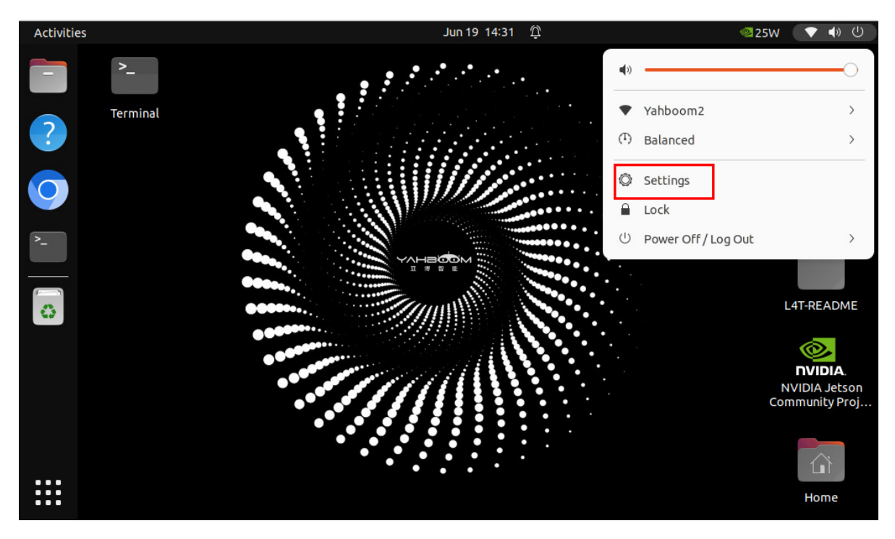
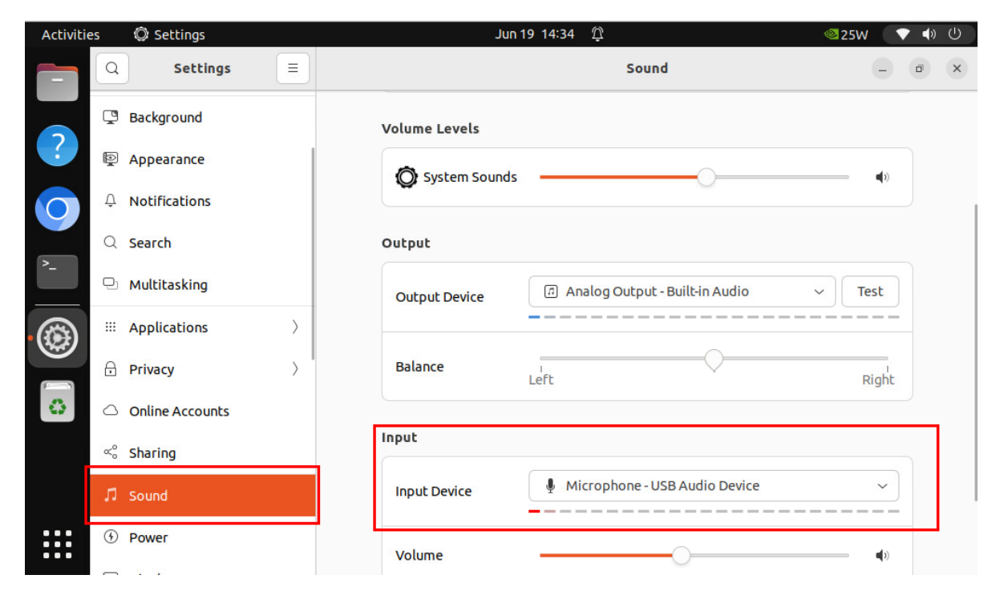

# **Semantic understanding of instructions following**

## **1. Course Content**

After running the large model program, users can interact with the robot through voice conversation. User voice commands are first converted into text by the speech recognition large model. The text is then used by the large model and visual multimodality to accurately understand the user's commands and voice. Finally, the robot performs the specified actions according to the user's instructions and responds to the user.

# **2. Preparation**

### **2.1 Content Description**

This course uses the Jetson Orin NX as an example. For Raspberry Pi and Jetson Nano boards, you need to open a terminal on the host computer and enter the command to enter the Docker container. Once inside the Docker container, enter the commands mentioned in this course in the terminal. For instructions on entering the Docker container from the host computer, refer to the **[Configuration and Operation Guide] -- [Enter the Docker (Jetson Nano and Raspberry Pi 5 users see here)]** section of this product tutorial. For Orin and NX boards, simply open a terminal and enter the commands mentioned in this course.

### **2.2 Start the agent**

**Note: To test all cases, you must first start the docker agent. If it has already been started, you do not need to start it again**

Enter the command in the vehicle terminal:

```
sh start_agent.sh
```

The terminal prints the following information, indicating that the connection is successful

# **3. Run the case**

### **3.1 Start the program**

Open the terminal on the vehicle and enter the command:

ros2 launch largemodel largemodel\_control.launch.py

After initialization is complete, the following content will be displayed

### **3.2 Test case**

Here are two reference test cases. Users can compile their own test instructions

- Please move forward quickly for 1 meter, then slowly back away 0.5 meters like a turtle. Then, turn left 30 degrees, turn right 90 degrees, then move horizontally 0.5 meters to the left, and then move horizontally 10 centimeters to the right.
- Please perform a dance first, then tell me a joke about a kitten and a puppy.

#### **3.2.1 Example 1**

First, wake the robot using "Hi, yahboom." The robot responds: "I'm here, please." After the robot responds, the buzzer beeps briefly (beep-). The user can then speak. The robot will detect sound activity, printing 1 if there is sound activity and 0 if there is no sound activity. When the speech ends, it detects the end of the voice, and stops recording if there is silence for more than 1 second.

The following figure shows the Voice Active Detection (VAD):

The robot will first communicate with the user, then respond to the user's instructions. The terminal will then print the following information:

Interpretation of the large model's response:

- **Decision-making layer large model output:** 1. Quickly move forward 1 meter, slowly retreat 0.5 meters, turn left 30 degrees, turn right 90 degrees, move 0.5 meters to the left, and move 0.1 meters to the right.
- **Decision-making model output:** action": ['set\_cmdvel(0.5, 0, 0, 2)', 'set\_cmdvel(-0.1, 0, 0, 5)', 'move\_left(30, 1.5)', 'move\_right(90, 1.5)', 'set\_cmdvel(0, 0.5, 0, 1)', 'set\_cmdvel(0, -0.1, 0, 1)'], "response": Okay, I'll start executing your instructions now. I'll move forward quickly, then slowly move back, and then spin around like I'm doing a complicated dance. , action": ['finishtask()'], "response": I've completed all the actions. It feels like I've completed a wonderful dance performance! If you have other tasks you need my help with, feel free to let me know!

The action list contains **finishtask()**, indicating that the execution layer model has determined that the robot has completed the user's command and entered the **waiting state**. At this point, you can wake Xiaoya up again to end the current task:

#### **3.2.2 Case 2**

Similar to the test in Case 1, first wake the robot with "Hello Xiaoya". After the robot responds, the buzzer beeps briefly (beep). The user can then speak. After the speech is complete, the robot responds and dances according to the user's instructions.

## **4. Code Analysis**

This lesson uses the basic programming framework for the basic AI embodied intelligence gameplay. For code analysis, refer to the [2. AI Large Model Basics - 4. Embodied Intelligence Gameplay Core Source Code Interpretation] section.

# **5. Common Problem Solutions**

### **5.1 Microphone Recording Too Sensitive**

If you find that the VAD Voice Activity Detection indicator remains "1" after the speaking phase and you cannot stop recording, this indicates that the microphone is set too sensitively and there is constant voice activity. You can try reducing the microphone sensitivity.

First, connect to the robot car screen via VNC. Click the options bar in the upper right corner to find the Settings option.


[Image details](images/img_001.md)

Scroll down to the Settings list on the left and find the Sound option. On the Sound page, find the Input Device. Drag the Volume button below to adjust the sensitivity. Try adjusting it to a comfortable value while recording.


[Image details](images/img_002.md)

# **5.2 Microphone Recording Insensitivity**

If the speaker is far away from the robot, the VAD voice activity detection function may not detect voice activity, causing the recording to end prematurely before the speaker finishes speaking. In this case, refer to the steps in **5.1 Microphone Recording Excessively Sensitive** to increase the microphone sensitivity.

#### **Note:**

If the microphone sensitivity is set too high, it may misinterpret ambient noise as speech activity.

### **5.3 Incomplete Speech Recognition**

Different speech recognition models may have different recognition performance for the same audio. We recommend using the default Paraformer series model or the local SenseVoiceSmall model. (The local speech recognition model is currently only available on the Jetson Orin Nano and Jetson Orin NX series.) For instructions on switching speech models, refer to [2. AI Large Model Basics - 5. Configuring the AI Large Model].