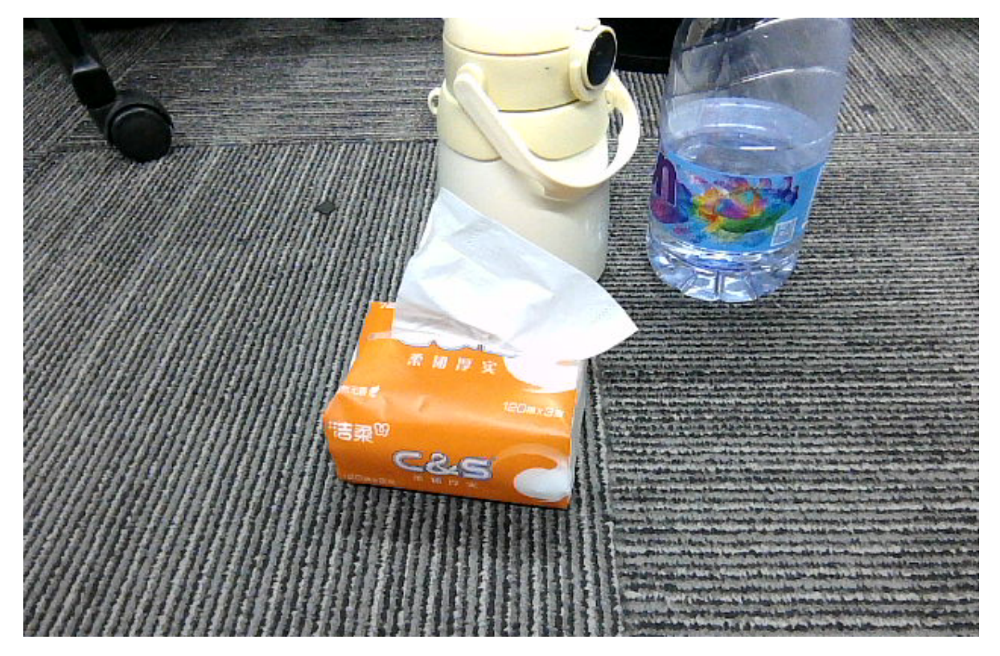
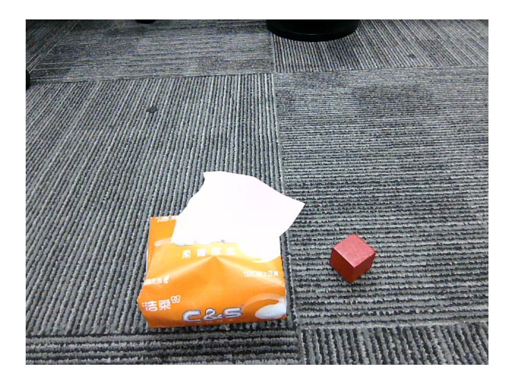

# **Multimodal visual understand**

## **1. Course Content**

- 1. Learn to use the robot's visual understanding capabilities
- 2. Learn new key source codes

# **2. Preparation**

### **2.1 Content Description**

This course uses the Jetson Orin NX as an example. For Raspberry Pi and Jetson Nano boards, you need to open a terminal on the host computer and enter the command to enter the Docker container. Once inside the Docker container, enter the commands mentioned in this course in the terminal. For instructions on entering the Docker container from the host computer, refer to the **[Configuration and Operation Guide] -- [Enter the Docker (Jetson Nano and Raspberry Pi 5 users see here)]** section of this product tutorial. For Orin and NX boards, simply open a terminal and enter the commands mentioned in this course.

### **2.2 Start the Agent**

**Note: To test all cases, you must start the docker agent first. If it has already been started, you do not need to start it again.**

Enter the command in the vehicle terminal:

```
sh start_agent.sh
```

The terminal prints the following information, indicating that the connection is successful

# **3. Run the case**

### **3.1 Startup Program**

Open the terminal on the vehicle and enter the command:

```
ros2 launch largemodel largemodel_control.launch.py
```

Wait for the initialization program to complete, as shown below:

#### **3.2 Test Cases**

Here are two reference test cases, users can write their own dialogue instructions

- Please show me what items are in front of you and tell me what they are used for.
- Please look in front of you to see if there is a blue cube and a pack of tissues. If yes, nod your head. If not, shake your head.

#### **3.2.1 Case 1**

First, use "Hi, yahboom" to wake up the robot. The robot responds: "I'm here, please tell me what to do." After the robot answers, the buzzer beeps briefly (beep—). The user can speak. After speaking, wait for the robot to reply. The terminal prints the following information:

Robot's perspective:


[Image details](images/img_001.md)

The robot executes the finishtask() function, proving that it has completed the user's instructions and entered **the waiting state** . After the user wakes up the robot again, they can choose to end the current task cycle and start a new task, or continue testing in the current task cycle. In this example, case 2 is tested directly in a task cycle (note that the robot is required to "observe the environment again").

#### **3.2.2 Case 2**

Wake up the robot, after the buzzer sounds briefly (beep—) after answering, say the test command, the terminal prints the following information

Robot's perspective:


[Image details](images/img_002.md)

## **4. Source code analysis**

The source code is located at:

jetson orin nano, jetson orin NX host:

/home/jetson/M3Pro\_ws/src/largemodel/largemodel/action\_service.py

/home/jetson/M3Pro\_ws/src/largemodel/largemodel/model\_service.py

Jetson Nano, Raspberry Pi host:

You need to enter docker first

/home/jetson/M3Pro\_ws/src/largemodel/largemodel/action\_service.py

root/M3Pro\_ws/src/largemodel/largemodel/model\_service.py

action\_service.py program:

In the init\_ros\_comunication method of the CustomActionServer class, a topic publisher called seewhat\_handle is created to publish visual processing signals.

```
# Create a publisher and publish the seewhat_handle topic
self.seewhat_handle_pub = self.create_publisher(String, 'seewhat_handle', 1)
```

When the action server calls the seewhat method, it publishes a signal to the seewhat\_handle topic, notifying the model server model\_service node to upload an image to the multimodal large model.

```
def seewhat(self):
    msg = String(data='seewhat')
    self.seewhat_handle_pub.publish(msg)#Normalize, publish the seewhat topic,
and let the master node call the large model
```

model\_service.py program:

In the init\_ros\_comunication method of the LargeModelService class

Created a seewhat\_handle topic subscriber to receive visual processing signals

Created a camera/color/image\_raw topic subscriber to receive the color image from the depth camera

```
#Create a seehat subscriber
self.seewhat_sub = self.create_subscription(String,'seewhat_handle',
self.seewhat_callback,1)
#ImageTopicSubscribers
self.subscription = self.create_subscription(Image,self.image_topic,
self.image_callback,1)
```

When the seewhat\_callback callback function receives the visual processing signal, it calls the dual\_large\_model\_mode method to first save an image from the depth camera and then upload it to the multimodal large model.

```
def seewhat_callback(self,msg):
    if msg.data == "seewhat":
        if self.use_double_llm:#Online model inference method: decision layer
reasoning + execution layer supervision
            self.dual_large_model_mode(type="image")
        else:#single model reasoning mode
            self.single_largeModel_infer(image_path=self.image_save_path)
```

The image\_callback callback function will continue to subscribe to the color image of the depth camera. When the image needs to be saved, the save\_single\_image method will be called to save an image.png image file.

Image save path:

jetson orin nano, jetson orin NX host:

```
/home/jetson/M3Pro_ws/install/largemodel/share/largemodel/resources_file/image.p
ng
```

Jetson Nano and Raspberry Pi host need to enter docker first:

root/M3Pro\_ws/install/largemodel/share/largemodel/resources\_file/image.png

```
def image_callback(self, msg):#Image callback function
        self.image_msg = msg
def save_single_image(self):
    if self.image_msg is None:
        self.get_logger().warning('No image received yet.')
        return
    try:
        #Image callback function
        cv_image = self.bridge.imgmsg_to_cv2(self.image_msg, 'bgr8')
        # Save the image
        cv2.imwrite(self.image_save_path, cv_image)
        # self.get_logger().info(f'Saved image: {self.image_save_path}')
    except Exception as e:
        self.get_logger().error(f'Error saving image: {e}')
```