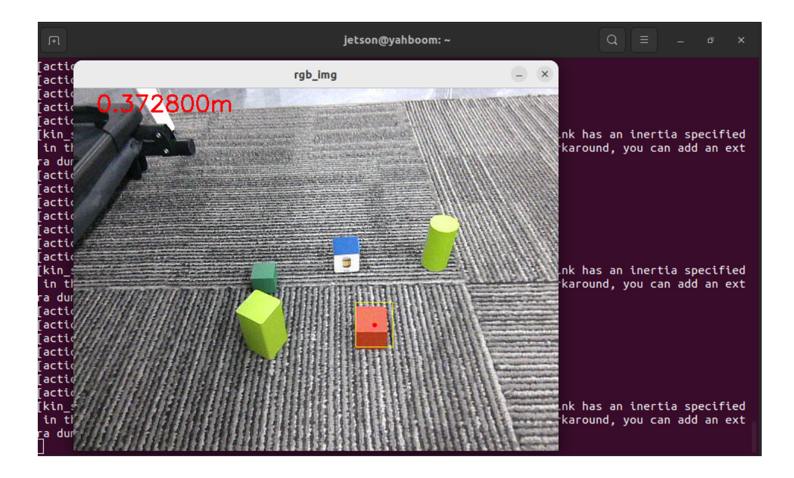
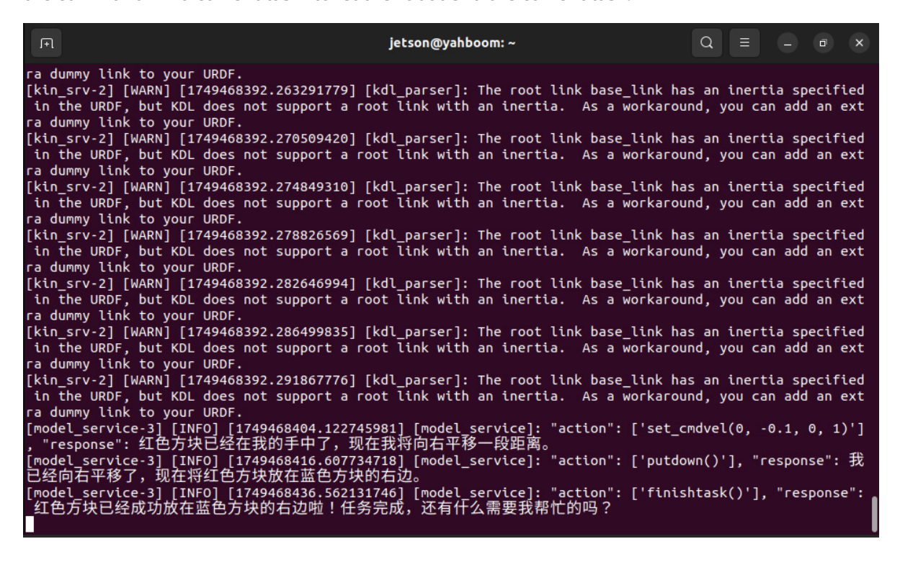
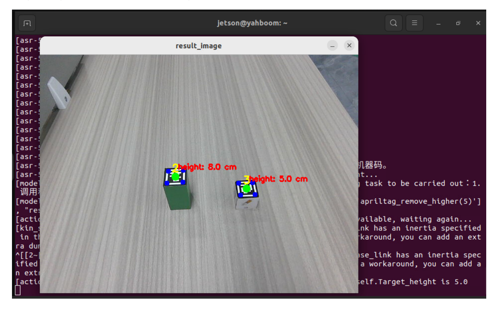
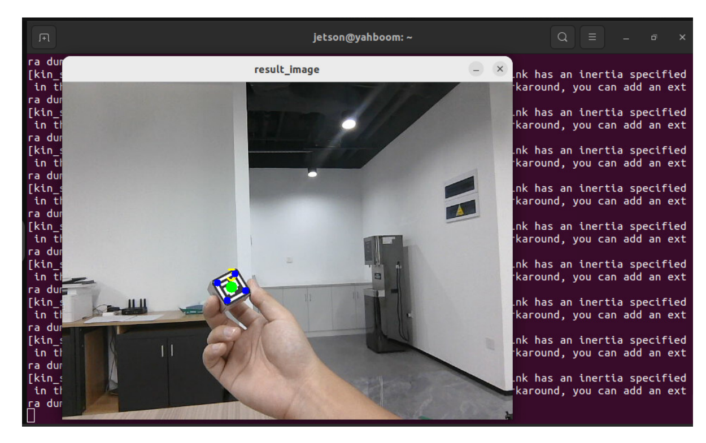
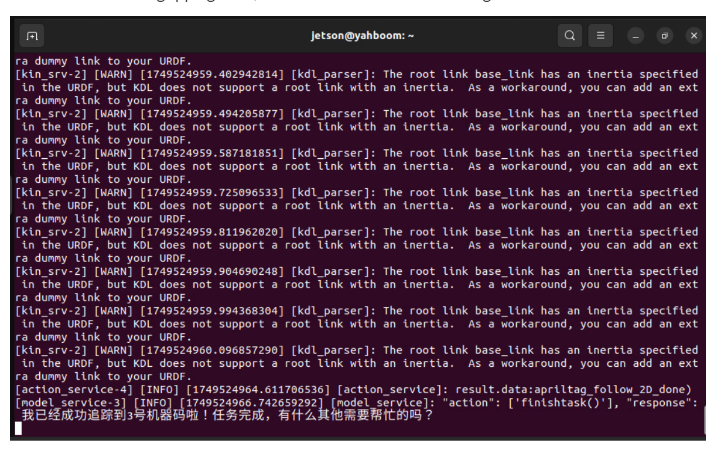
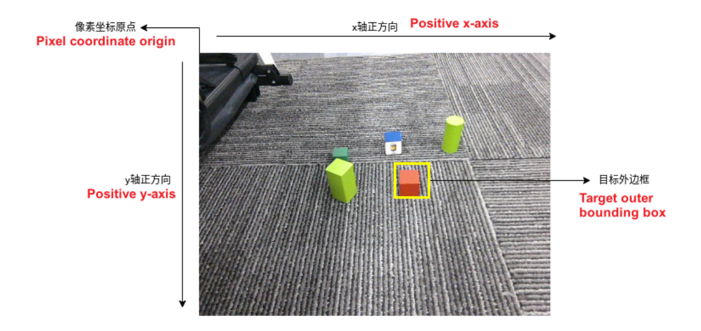

# **Multimodal visual understand+robotic arm grab**

# **1. Course Content**

- 1. Learning to use the robot's visual understanding combined with the robot's gripping capabilities
- 2. Analyze the newly emerged key source code
- 3. Note: For the same test command, the big model's responses will not be exactly the same and will be slightly different from the screenshots in the tutorial. If you need to increase or decrease the diversity of the big model's responses, refer to the section on configuring the decision-making big model parameters in the [2. AI Big Model Basics - 5. Configuring the AI Big Model] course.

## **2. Preparation**

### **2.1 Content Description**

This course uses the Jetson Orin NX as an example. For Raspberry Pi and Jetson Nano boards, you need to open a terminal on the host computer and enter the command to enter the Docker container. Once inside the Docker container, enter the commands mentioned in this course in the terminal. For instructions on entering the Docker container from the host computer, refer to the **[Configuration and Operation Guide] -- [Enter the Docker (Jetson Nano and Raspberry Pi 5 users see here)]** section of this product tutorial. For Orin and NX boards, simply open a terminal and enter the commands mentioned in this course.

### **2.2 Start the Agent**

**Note: To test all cases, you must start the docker agent first. If it has already been started, you do not need to start it again.**

Enter the command in the vehicle terminal:

sh start\_agent.sh

The terminal prints the following information, indicating that the connection is successful

# **3. Run the case**

### **3.1 Startup Program**

Connect to the vehicle computer screen via VNC, open the terminal and enter the command:

```
ros2 launch largemodel largemodel_control.launch.py
```

Wait for the initialization program to complete, as shown below:

### **3.2 Test Cases**

Here are two test cases. Users can compile their own test instructions.

- Find the red block in front of you and grab it
- Place the red block in front of you to the right of the blue block
- Please help me remove the machine code in front of you that is higher than 5 cm
- Tracking machine number three

#### **3.2.1 Example 1: "Find the red block in front of you and grab it"**

First, use "Hi, yahboom" to wake up the robot. The robot responds: "I'm here, please tell me what to do." After the robot responds, the buzzer beeps briefly (beep—). The user can speak and wait for the robot to reply after speaking. The terminal prints the following information:

grasp\_obj() After the function is called, a window titled **rgb\_img** will open on the VNC screen , displaying the image from the robot's current perspective. The robot will automatically adjust the distance to the target object. After the distance adjustment is complete, the robot will use its robotic arm to grasp the target object.


[Image details](images/img_001.md)

After the test is completed, wake up the robot again to let it end the current task.

Note: After the robot grabs an object, the robotic arm will be in a maintenance state. If you need the robotic arm to return to its initial state, you can use the following method

- Method 1: Wake up the robot again and let it put down the red block it just grabbed
- Method 2: Wake up the robot again and issue the command "End current task" to let the robot end the current task. After the task cycle is completed, the robot arm will reset to its initial posture.

#### **3.2.2 Case 2: "Place the red block in front of you to the right of the blue block"**

After waking up the robot, say the command "Place the red square in front of you to the right of the blue square." The terminal prints the following information. Based on the output of the decision-making model, the robot's strategy for completing the task is: 1. Identify the image—2. Locate the red square—3. Grab the red square—4. Move it to the right—5. Place the square.

When the robot completes the task, it enters the waiting state. Wake up the robot again and issue the command "End current task" to let the robot end the current task.


[Image details](images/img_002.md)

#### **3.2.3 Case 3: "Please help me remove the machine code in front of you that is higher than 5 cm"**

After waking up the robot, say the command "Please remove the machine code in front of you that is higher than 5 cm." The terminal prints the following information

The terminal will open a window titled **result\_image** , where you can see the height of each machine code. After the distance measurement is stable, the robot will automatically adjust the distance between itself and the target, then use the robotic arm to grab the machine code at the target height and transfer it to the right side of the robot.


[Image details](images/img_003.md)

After the gripping is completed, the robot will enter the waiting state. Wake up the robot again and issue the command "end current task" to let the robot end the current task.

#### **3.2.4 Case 4: "Tracking Machine Number 3"**

After waking up the robot, say the command "track machine code number 3" and the terminal will print the following information.

**A window titled "result\_image"** will open in the terminal . The robot's view will then follow the movement of the machine code. After the machine code stops moving, the robot will adjust its distance to the machine code and then grab the machine code in mid-air.


[Image details](images/img_004.md)

After the gripping is completed, the robot will give a voice prompt that the task is completed, the robotic arm is in the gripping state, and the robot enters the waiting state


[Image details](images/img_005.md)

Wake up the robot again and give it a rest command, and the robot will end its current task.

# **4. Source code analysis**

The source code is located at:

jetson orin nano, jetson orin NX host:

```
/home/jetson/M3Pro_ws/src/largemodel/largemodel/action_service.py
```

Jetson Nano, Raspberry Pi host:

You need to enter docker first

```
root/M3Pro_ws/src/largemodel/largemodel/action_service.py
```

### **4.1 Case 1**

action\_service.py program:

**In Example 1, the seewhat** and **grasp\_obj** methods in **the CustomActionServer** class are used . **The seewhat** function mainly obtains the color image of the depth camera. It has been explained in the **Multimodal Visual Understanding section. Here, the grasp\_obj** function is explained.

The coordinate rules of objects in the robot arm's grasping perspective are shown in the figure below:


[Image details](images/img_006.md)

In the init\_ros\_comunication method of **the CustomActionServer** class, a topic publisher named corner\_xy is created to publish the coordinates of the outer frame of the target to be gripped, and a topic subscriber named largemodel\_arm\_done is created to receive the signal that the robotic arm has completed gripping.

```
# Create an object position publisher and publish the coordinates of the object
to be clamped
self.bject_position_pub = self.create_publisher(Int16MultiArray, 'corner_xy', 1)
#Create a robot arm to complete the topic subscriber
self.largemodel_arm_done_sub =
self.create_subscription(String,'/largemodel_arm_done',self.largemodel_arm_done_
callback,1)
```

**The grasp\_obj(x1, y1, x2, y2)** function is used to call the robotic arm to grasp the target object. The parameters are the coordinates of the upper left vertex and lower right vertex of the outer border of the object to be grasped (the upper left corner of the image is the pixel coordinate origin). For example, the coordinates of the outer border of the red square to be grasped in Case 1 can be known from the response of the large model: the coordinates of the upper left corner are (365,200) and the coordinates of the lower right corner are (408,261).

grasp\_obj starts three child processes: **grasp\_desktop** , **KCF\_follow** , and **ALM\_KCF\_Tracker\_Node** , and passes the parameters given by the AI model to the **ALM\_KCF\_Tracker\_Node** node through the topic. It then rclpy.spin\_until\_future\_complete(self, self.grasp\_obj\_future) blocks the main process and waits for the grasping to complete.

```
def grasp_obj ( self , x1 , y1 , x2 , y2 ):
    process_1 = subprocess . Popen ([ 'ros2' , 'run' , 'largemodel_arm' ,
'grasp_desktop' ])
    time.sleep ( 2.0 ) #Sleep for 2 seconds to wait for the thread to stabilize
```

```
process_2 = subprocess . Popen ([ 'ros2' , 'run' , 'largemodel_arm' ,
'KCF_follow' ])
    process_3 = subprocess . Popen ([ 'ros2' , 'run' , 'M3Pro_KCF' ,
'ALM_KCF_Tracker_Node' ])
    time . sleep ( 3.0 ) #Sleep for 3 seconds to wait for the thread to
stabilize
    # Convert the argument from a string to an integer
    x1 = int ( x1 )
    y1 = int ( y1 )
    x2 = int ( x2 )
    y2 = int ( y2 )
    msg1 = Int16MultiArray ( data = [ x1 , y1 , x2 , y2 ])
    self . bject_position_pub . publish ( msg1 )
    rclpy . spin_until_future_complete ( self , self . grasp_obj_future )
    result = self . grasp_obj_future . result ()
    if result .data == 'grasp_obj_done ' :
        self . action_status_pub ( f'Robot feedback: Execution of
grasp_obj({x1},{y1},{x2},{y2}) completed' )
    else :
        self . action_status_pub ( f'Robot feedback: Execution of
grasp_obj({x1},{y1},{x2},{y2}) failed' )
    self . kill_process_tree ( process_1 . pid )
    self . kill_process_tree ( process_2 . pid )
    self . kill_process_tree ( process_3 . pid )
self . grasp_obj_future = Future () # Reset the Future object
```

After the grasp is completed, **the KCF\_follow** node will publish a signal of **the largemodel\_arm\_done** topic with the content " **grasp\_obj\_done** ", set the **grasp\_obj\_future object in the largemodel\_arm\_done\_callback** callback function , and then exit the blocking in the **grasp\_obj function. Then, the kill\_process\_tree** method is called to recursively kill the process tree of the child process, and finally the status of the execution action is fed back to the execution layer large model. rclpy.spin\_until\_future\_complete(self, self.grasp\_obj\_future)

```
def largemodel_arm_done_callback ( self , msg ): #Callback function for the
robotic arm to complete the grabbing process
   if msg .data in [ 'apriltag_sort_done' , ' apriltag_sort_failed' ]:
       if not self . apriltag_sort_future . done ():
           self . apriltag_sort_future . set_result ( msg )
   elif msg . data == 'apriltag_follow_2D_done' :
       if not self . apriltag_follow_2D_future . done ():
           self . apriltag_follow_2D_future . set_result ( msg )
   elif msg . data in [ 'apriltag_remove_higher_done' ,
'apriltag_remove_higher_failed' ]:
       self . get_logger () . info ( f'msg.data:{msg.data}' )
       if not self . apriltag_remove_higher_future . done ():
           self . apriltag_remove_higher_future . set_result ( msg )
   elif msg . data == 'color_follow_2D_done' :
       if not self . color_follow_2D_future . done ():
           self . color_follow_2D_future . set_result ( msg )
   elif msg . data == 'color_sort_done' :
       if not self . color_sort_future . done ():
           self . color_sort_future . set_result ( msg )
   elif msg . data == 'grasp_obj_done' :
```

```
if not self . grasp_obj_future . done ():
       self . grasp_obj_future . set_result ( msg )
elif msg . data == 'color_remove_higher_done' :
   if not self . color_remove_higher_future . done ():
       self . color_remove_higher_future . set_result ( msg )
elif msg . data == 'follw_line_clear_future_done' :
   if not self . follw_line_clear_future . done ():
       self . follw_line_clear_future . set_result ( msg )
```

### **4.2 Case 2**

action\_service.py program:

Case 2 uses **the seewhat** , **grab\_obj** , and **set\_cmdvel** methods in **the CustomActionServer** class . **The seewhat** and **grab\_obj** functions have been explained in Case 1. Here we explain the newly appeared **set\_cmdvel** function.

**set\_cmdvel** is a function that controls the movement of the robot chassis. It does this by setting the x- and y-axis speeds and the z-axis angular velocity, publishing the cmd\_vel topic, and then feeding back the status of the execution action to the execution layer model.

```
#Create a speed topic publisher
self . publisher = self . create_publisher ( Twist , self . Speed_topic , 10 )
```

```
def set_cmdvel ( self , linear_x , linear_y , angular_z , duration ): #Publish
cmd_vel
    # Convert the argument from string to floating point
    linear_x = float ( linear_x )
    linear_y = float ( linear_y )
    angular_z = float ( angular_z )
    duration = float ( duration )
    twist = Twist ()
    twist . linear . x = linear_x
    twist . linear . y = linear_y
    twist . angular . z = angular_z
    self . _execute_action ( twist , durationtime = duration )
    self . stop ()
    if self . combination_mode : #Is it combination mode? The combination model
needs to be executed.
        return
    else :
        self . action_status_pub ( f'Robot feedback: Execution of
set_cmdvel({linear_x},{linear_y},{angular_z},{duration}) completed' )
```

### **4.3 Case 3**

action\_service.py program:

Case 3, using the **apriltag\_remove\_higher** method in **the CustomActionServer class**

The program principle is similar to that of Case 1. The child process is started as **the grab\_desktop\_remove** and **apriltag\_remove\_higher** nodes, and is blocked until the **largemodel\_arm\_done\_callback** callback function receives " **apriltag\_remove\_higher\_done** " or " **apriltag\_remove\_higher\_failed** ". Then, it exits the blocking, kills the process tree of the child process, and then feeds back the status of the execution action to the execution layer large model.

```
def apriltag_remove_higher(self,target_high):#Remove the machine code of the
specified height
   target_highf = float(target_high)/100
   process_1 = subprocess.Popen(['ros2', 'run', 'largemodel_arm',
'grasp_desktop_remove'])
   time.sleep(4)#wait for thread to stabilize
   process_2 = subprocess.Popen(['ros2', 'run', 'largemodel_arm',
'apriltag_remove_higher','--ros-args','-p',f'target_high:={target_highf:.2f}'])
   rclpy.spin_until_future_complete(self, self.apriltag_remove_higher_future)
   result=self.apriltag_remove_higher_future.result()
   if result.data== 'apriltag_remove_higher_done':
       self.action_status_pub(f'机器人反馈:执行
apriltag_remove_higher({target_high})完成')
   elif result.data== 'apriltag_remove_higher_failed':
       self.action_status_pub(f'机器人反馈:执行执行
apriltag_remove_higher({target_high})失败')
   self.kill_process_tree(process_1.pid)
   self.kill_process_tree(process_2.pid)
   self.apriltag_remove_higher_future = Future() # Reset the Future object
   self.pubSix_Arm(self.init_joints)
```

### **4.4 Case 4**

action\_service.py program:

Case 4, using the **apriltag\_follow\_2D** method in **the CustomActionServer class**

The program principle is similar to the previous cases. The subprocesses started are **grab** and **apriltag\_follow\_2D** . The subprocesses will block the program until **the largemodel\_arm\_done\_callback** callback function receives " **apriltag\_follow\_2D\_done** ", and then feedback the status of the execution action to the execution layer large model.

```
def apriltag_follow_2D(self,target_id):#Tracking machine code
   target_idf = float(target_id)
   process_1 = subprocess.Popen(['ros2', 'run', 'largemodel_arm', 'grasp'])
   process_2 = subprocess.Popen(['ros2', 'run', 'largemodel_arm',
'apriltag_follow_2D','--ros-args','-p',f'target_id:={target_idf:.1f}'])
   rclpy.spin_until_future_complete(self, self.apriltag_follow_2D_future)
   result=self.apriltag_follow_2D_future.result()
   self.get_logger().info(f'result.data:{result.data})')
   if result.data =='apriltag_follow_2D_done':
       self.action_status_pub(f'机器人反馈:执行apriltag_follow_2D({target_id})完
成')
   else:
       self.action_status_pub(f'机器人反馈:执行执行apriltag_follow_2D({target_id})
失败')
   self.kill_process_tree(process_1.pid)
```

```
self.kill_process_tree(process_2.pid)
self.apriltag_follow_2D_future = Future() # Reset the Future object
```