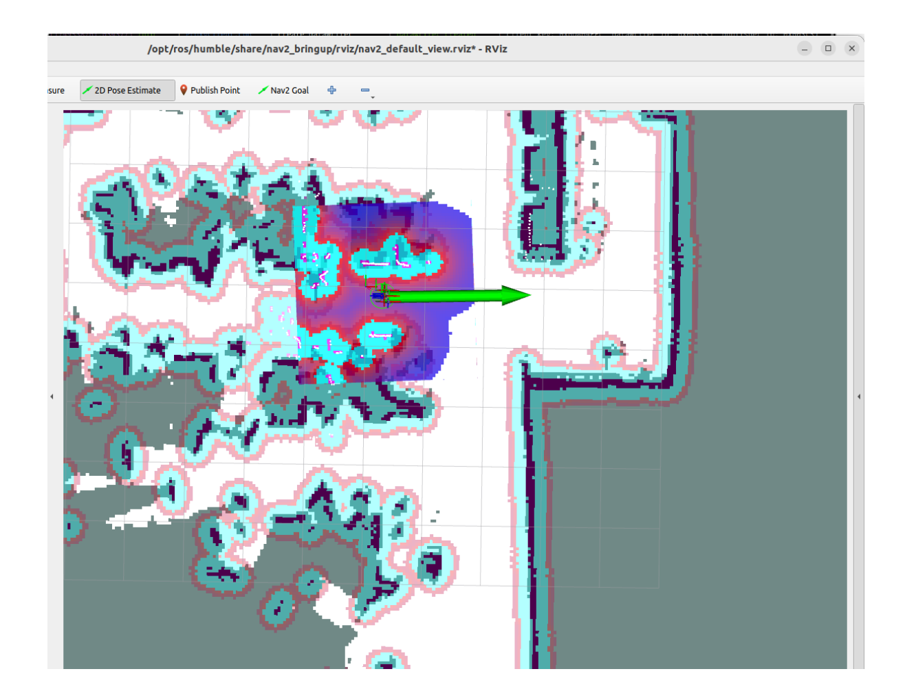
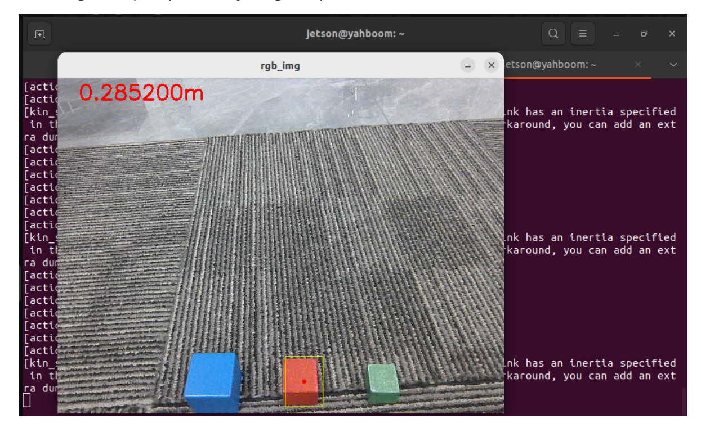
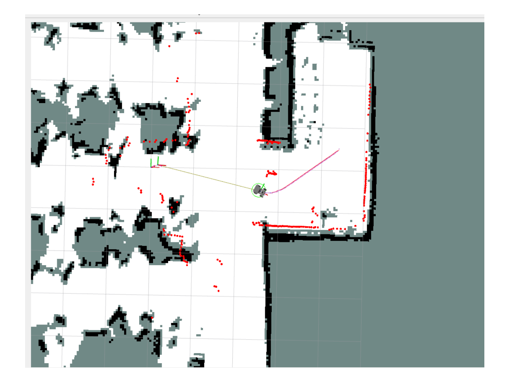
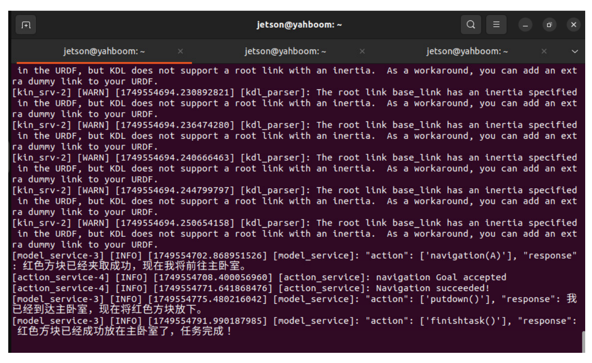

# **Robotic arm gripping + multimodal visual understanding + SLAM navigation**

## **1. Course Content**

- 1. Learn robot SLAM navigation, robotic arm gripping, and AI large model visual understanding composite function cases
- 2. Study the new key source code in the tutorial
- 3. **Note: This section requires you to first configure the map mapping file according to the previous section Multimodal Visual Understanding + SLAM Navigation**

# **2. Preparation**

## **2.1 Content Description**

This course uses the Jetson Orin NX as an example. For Raspberry Pi and Jetson Nano boards, you need to open a terminal on the host computer and enter the command to enter the Docker container. Once inside the Docker container, enter the commands mentioned in this course in the terminal. For instructions on entering the Docker container from the host computer, refer to the **[Configuration and Operation Guide] -- [Enter the Docker (Jetson Nano and Raspberry Pi 5 users see here)]** section of this product tutorial. For Orin and NX boards, simply open a terminal and enter the commands mentioned in this course.

### **2.2 Start the Agent**

**Note: To test all cases, you must start the docker agent first. If it has already been started, you do not need to start it again.**

Enter the command in the vehicle terminal:

```
sh start_agent.sh
```

The terminal prints the following information, indicating that the connection is successful

## **3. Run the case**

#### **3.1 Startup Program**

Connect to the robot desktop via VNC, open a terminal, and start the command

```
ros2 launch largemodel largemodel_control.launch.py
```

After initialization is complete, the following content will be displayed

Open two terminals on the vehicle and enter the following commands:

```
ros2 launch M3Pro_navigation base_bringup.launch.py
ros2 launch M3Pro_navigation navigation2.launch.py
```

Create a new terminal on the virtual terminal and start

```
ros2 launch slam_view nav_rviz.launch.py
```

Then follow the process of starting the navigation function to initialize the positioning. The rviz2 visualization interface will open. Click **2D Pose Estimate** in the upper toolbar to enter the selection state. Roughly mark the position and orientation of the robot on the map. After initialization positioning, the preparation work is completed.


[Image details](images/img_001.md)

#### **3.2 Test Cases**

Here are some test cases for reference. Users can write their own dialogue commands.

I am in the master bedroom now. Please help me take the red block in front of you to the master bedroom.

First, use "Hi, yahboom" to wake up the robot. The robot responds: "I'm here, please tell me what to do." After the robot answers, the buzzer beeps briefly (beep—), and the user can speak. After the robot replies, the terminal prints the following information:

The decision-making model planning task steps are:

According to the task steps planned by the decision-making model, the robot will first observe the environment in front of it, then grab the red square, and then navigate to the target point according to the path planned by the global planner.


[Image details](images/img_002.md)


[Image details](images/img_003.md)

After arriving at the navigation target point, the robot will use its robotic arm to put down the red block in its hand and prompt the user that the task is completed. At this time, the robot enters a waiting state, and the user can choose to continue the conversation or command the robot to end the current task and start a new task cycle.


[Image details](images/img_004.md)

## **4. Source code analysis**

jetson orin nano, jetson orin NX host:

```
/home/jetson/M3Pro_ws/src/largemodel/largemodel/src/largemodel/largemodel/action
_service.py
```

Jetson Nano, Raspberry Pi host, you need to enter Docker first:

```
root/M3Pro_ws/src/largemodel/largemodel/src/largemodel/largemodel/action_service
.py
```

action\_service.py program:

The case uses **the seewhat** , **navigation** , **load\_target\_points** , **putdown** , and **grasp\_obj** methods in **the CustomActionServer class. Seewhat** , **navigation, load\_target\_points** , and **grasp\_obj** have been explained in the previous chapters [2. Multimodal Visual Understanding, 3. Multimodal Visual Understanding + Robotic Arm Grabbing, and 4. Multimodal Visual Understanding + SLAM Navigation]. Here we explain the newly appeared **putdown function.**

The putdown function controls the robotic arm to put down the object it has gripped. After gripping an object, the robotic arm will be in a gripping state. Calling this function allows the robotic arm to put down the gripped object. The principle is to control the robotic arm posture by publishing the robotic arm joint topic.

```
def putdown ( self ):
    self . pubSix_Arm ( self . putsown_joints ) # Lower the robotic arm
    time . sleep ( 3 )
    self . pubSingle_Arm ( 6 , 30 , 2000 ) #The robotic arm opens the grip and
puts down the item
    time . sleep ( 3 )
    self . pubSix_Arm ( self . init_joints ) #Robotic arm retracts
    self . action_status_pub ( f'Robot feedback: Execution of putdown()
completed' )
```